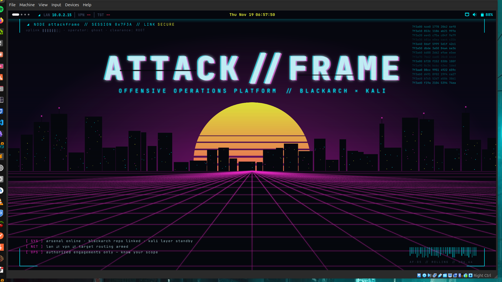
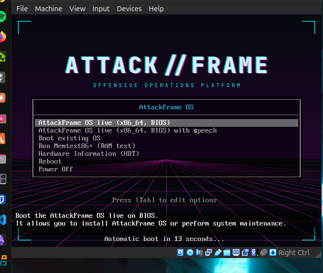
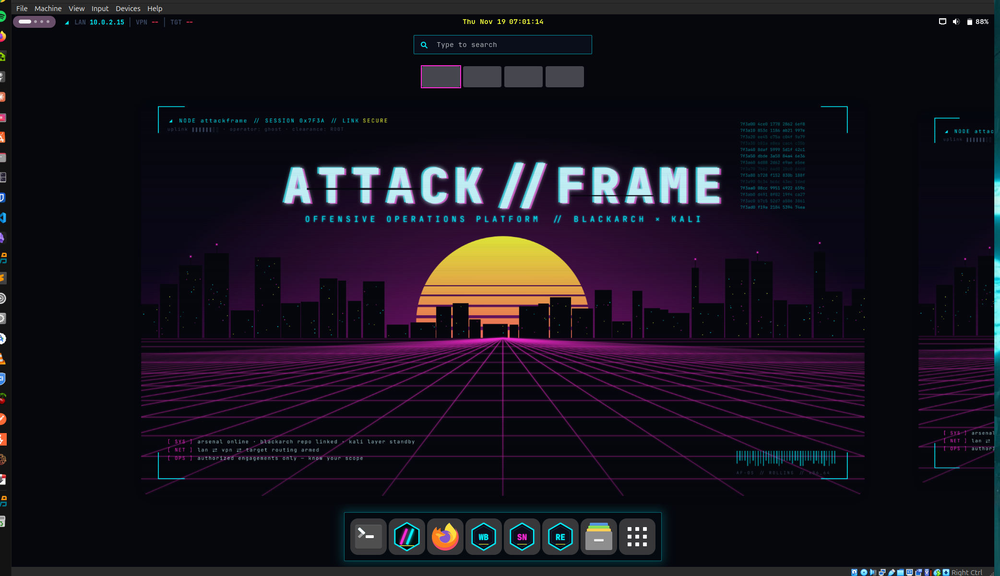
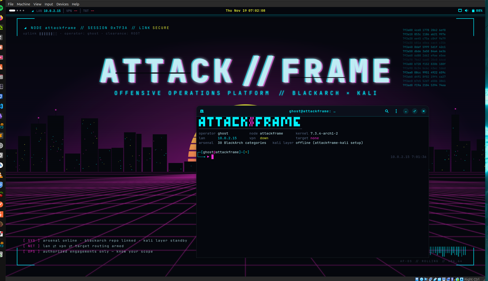
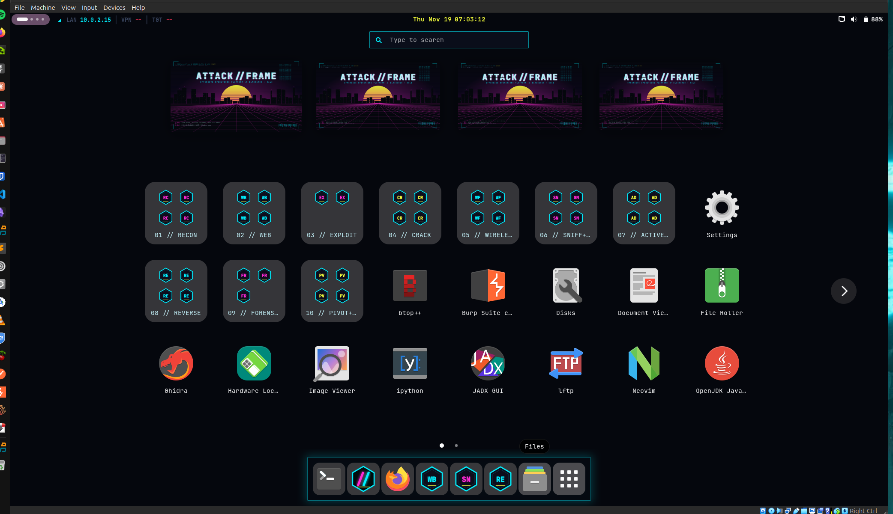
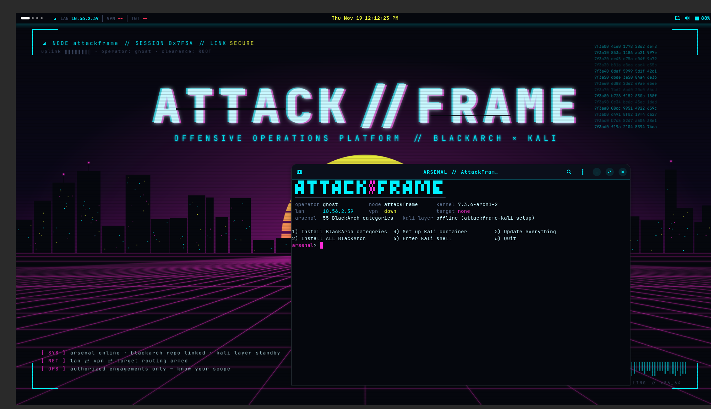

# AttackFrameOS

A cyberpunk penetration-testing distro: an **Ubuntu** base with a neon-HUD **GNOME** desktop, and two tool layers that run side by side as **Docker** containers — the full **Kali** repository and the full **BlackArch** repository. All artwork is original.

```
 ▄▀█ ▀█▀ ▀█▀ ▄▀█ █▀▀ █▄▀ ▞▞ █▀▀ █▀█ ▄▀█ █▀▄▀█ █▀▀
 █▀█  █   █  █▀█ █▄▄ █ █ ▞▞ █▀  █▀▄ █▀█ █ ▀ █ ██▄
```

## Why containers?

Kali is Debian (`.deb`/apt) and BlackArch is Arch (`.pkg.tar.zst`/pacman). Their packages can't share one root filesystem without breaking each other's libraries, and neither should break the host. AttackFrame keeps the host a clean Ubuntu LTS and puts each tool distro in its own box:

| Layer | Source | How | On the ISO |
| --- | --- | --- | --- |
| Host | **Ubuntu** (24.04 LTS by default) + GNOME | apt, casper live boot | desktop, drivers, Docker, distrobox |
| Kali | **kali-rolling** (every Kali metapackage) | distrobox `kali` on Docker — host network, raw sockets, shared `$HOME`, display | curated core image, baked in |
| BlackArch | **Arch + BlackArch** (~2,800 tools, 50+ categories) | distrobox `blackarch` on Docker — same | curated core image, baked in |

Both images ship pre-built inside the ISO (`/usr/share/attackframe/images/*.tar`) and are loaded into Docker the first time a box is created, so it works offline. Tools listed in `tools.tsv` get a shim in `/usr/local/bin`, so `nmap`, `sudo nmap`, `burpsuite`, `katana` … work straight from the host shell and the app grid. Anything else: `kali <cmd>` / `blackarch <cmd>`.

## Build

Needs Docker with the Compose plugin (`sudo apt install docker.io docker-buildx docker-compose-v2`), ~60 GB free disk, a few GB RAM, and a good connection. Works on any Linux host. `build.sh` uses your Docker daemon directly if you're in the `docker` group, otherwise it re-runs itself with sudo.

The build runs in a privileged Ubuntu builder container defined in `docker-compose.yml` (`docker compose run --rm builder`). The builder uses your host's Docker daemon (socket mount) to build the Kali and BlackArch images, so they stay cached between builds.

```bash
./build.sh
```

| Variable | Default | Meaning |
| --- | --- | --- |
| `TOOLSET` | `core` | `minimal` = no images (pulled on first use) · `core` = curated Kali + BlackArch images · `large` = `kali-linux-default` + whole BlackArch groups in `BA_GROUPS` |
| `UBUNTU_SUITE` | `noble` | Ubuntu release to build on (e.g. `resolute` for 26.04) |
| `UBUNTU_MIRROR` | archive.ubuntu.com | apt mirror for the host system |
| `KERNEL_PKG` | `linux-generic-hwe-24.04` on noble | kernel metapackage |
| `KALI_META` | — | extra Kali metapackage baked into the Kali image |
| `BA_GROUPS` | recon webapp exploitation cracker wireless | groups used by `TOOLSET=large` |
| `STRAP_SHA1` | — | enforce BlackArch `strap.sh` checksum (published on blackarch.org/downloads) |
| `SQUASHFS_LEVEL` | `15` | zstd level for the root filesystem |

The ISO and its `.sha256` land in `out/`. Package names that vanish from the repos are skipped with a warning (inside the images they're logged to `/var/log/attackframe-skipped.txt`). Work files live in `.work/`, download caches in `.cache/` (both git-ignored).

Test it in a VM:

```bash
qemu-system-x86_64 -enable-kvm -m 8G -smp 4 -cdrom out/attackframe-*.iso -vga virtio -display gtk,gl=on
# UEFI: add  -bios /usr/share/ovmf/OVMF.fd
```

## Using it

The live session auto-logs in as `ghost` (passwordless sudo and the `docker` group, live only). On the live ISO Docker's storage lives in RAM, and a baked image is copied into it the first time its box is used. Loading an image briefly needs about twice its size in RAM, and the core Kali image is several GB. On a live USB, either give the machine plenty of RAM or let Docker use a disk instead:

```bash
# once: make a partition (on the boot USB's free space or any disk) and label it AF-DOCKER
sudo mkfs.ext4 -L AF-DOCKER /dev/sdX3
```

At boot, AttackFrame puts Docker's storage on a partition labelled `AF-DOCKER` when it finds one, so images load to disk and the boxes persist across live boots. An installed system doesn't need any of this.

| Command | What it does |
| --- | --- |
| `attackframe-arsenal menu` | interactive manager (also the **AttackFrame Arsenal** app) |
| `attackframe-arsenal status` | state of both boxes |
| `attackframe-arsenal install ba:webapp kali:tools-wireless katana` | install into either layer (bare names: BlackArch category → BlackArch, else Kali) |
| `attackframe-kali setup` [core\|default\|large\|everything\|top10\|tools-*] | create/extend the Kali box |
| `attackframe-blackarch setup` [core\|&lt;category&gt;\|full] | create/extend the BlackArch box |
| `kali <tool>` / `kali` | run a Kali tool / open a Kali shell |
| `blackarch <tool>` / `blackarch` (`ba`) | run a BlackArch tool / open a BlackArch shell |
| `attackframe-kali export <bin>` | put any box binary on the host PATH (`attackframe-blackarch export` likewise) |
| `attackframe-box sync` | re-index both boxes, rewrite shims + app-grid launchers |
| `target 10.10.11.5` | set the engagement target (shown in prompt + top-bar HUD, `$TGT`) |
| `lhost` | your VPN IP if a tunnel is up, else LAN IP (`$LHOST`) |
| `scan`, `fullscan` | nmap presets against `$TGT` |

`sudo <tool>` runs the tool as root inside its box (raw sockets, monitor mode, privileged ports).

### Install to disk

From the live session:

```bash
sudo attackframe-install /dev/nvme0n1 --user coenraad
```

Wipes the disk (GPT: BIOS-boot + 512 MiB EFI + ext4 root), copies the live system including the baked Kali/BlackArch images, creates your user and installs GRUB for both UEFI and legacy BIOS. UEFI boot works with Secure Boot on (Ubuntu's signed shim, GRUB and kernel), for both the ISO and the installed system. Your user is added to the `docker` group so the boxes and app-grid launchers work without a password prompt. Membership of `docker` is root-equivalent; add `--no-docker-group` to leave it out, in which case the boxes run through sudo.

## The look

-   **Palette** — void `#05070d`, cyan `#00f0ff`, magenta `#ff2bd6`, yellow `#f5ff3b`, ice `#c8f7ff`
-   **Shell theme** — built at boot from the stock GNOME dark theme + `overrides.css` (rebuilt by an apt hook after GNOME upgrades)
-   **HUD extension** — top bar shows `◢ LAN │ VPN │ TGT`, click to copy any of them
-   **App grid** — tools grouped into folders `01 // RECON` … `10 // PIVOT+C2` with hex icons; each launcher notes which box it runs in
-   **Terminal** — neon gnome-terminal profile, JetBrains Mono Nerd Font, operator prompt + banner showing both boxes
-   **GTK** — libadwaita/adw-gtk3 recoloured to match; Papirus-Dark icons; neon-framed overview dash

## Layout

```
build.sh                       host entry point (checks Docker, runs the builder via Docker Compose)
docker-compose.yml             the privileged Ubuntu builder service
scripts/build-in-container.sh  debootstrap + casper rootfs, layer images, squashfs, hybrid GRUB ISO
containers/kali/Containerfile       Kali layer image
containers/blackarch/Containerfile  Arch + BlackArch (strap.sh) layer image
packages/base.txt              Ubuntu base / live / installer packages
packages/desktop.txt           GNOME desktop + shell tools
packages/kali-core.txt         tools baked into the Kali image
packages/blackarch-core.txt    tools baked into the BlackArch image
scripts/gen-assets.py          regenerates assets/*.svg
scripts/gen-wallpapers{,2,3}.py  regenerate the 50-wallpaper pack
scripts/render-wallpapers.sh   renders the pack to 4K PNGs in assets/wallpapers/png/
assets/                        wallpaper, boot splash, icons (SVG sources)
profile/airootfs/              files overlaid on the Ubuntu root filesystem
```

Use only on systems you own or are authorised to test.

## Console

The console gives you access to Kali and BlackArch on the same instance. BlackArch has some interesting tools that Kali does not have.














